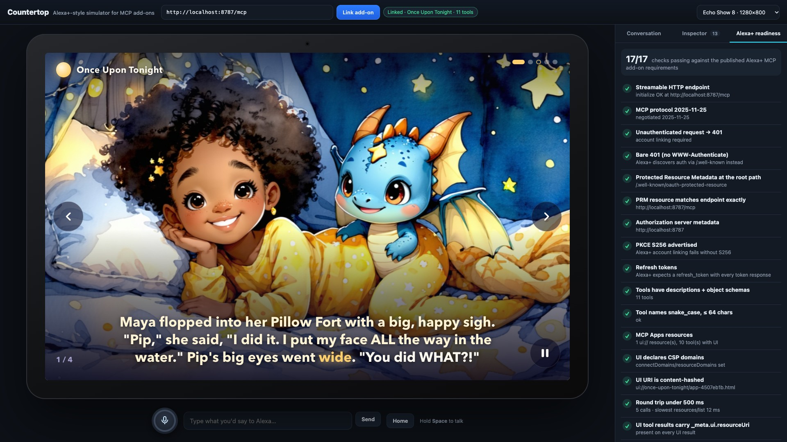
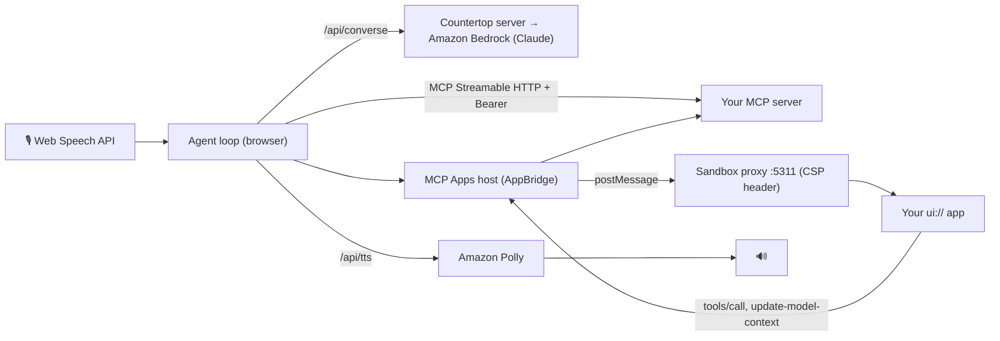

# Countertop

**An open-source, voice-first smart-display simulator for testing MCP servers and MCP Apps the way Alexa+ uses them:** account linking, Echo Show-sized screens, an LLM that chooses your tools, spoken replies, a JSON-RPC inspector, and an **Alexa+ readiness report**.



**Try it live:** https://d3eqnu2zudrdt1.cloudfront.net, a hosted copy pointed at the [Once Upon Tonight](https://github.com/PRIEST099/once-upon-tonight) demo add-on. Press **Link add-on**, allow, then type or hold Space to talk. It runs with `PUBLIC_DEMO=true`, which caps model and voice usage per visitor and per day.

## Why this exists

Alexa+ now integrates services through the **Model Context Protocol**. But the official Alexa+ add-on console, CLI and web simulator are **partner-only preview** today, so most developers, hackathon builders included, can't see their MCP server the way Alexa+ will use it. Countertop gives you that loop locally, in about a minute:

- **Talk to your add-on.** Push-to-talk (hold Space) uses the browser's speech recognition. Replies are spoken with Amazon Polly. Typing works too.
- **Captions.** What you said and what Alexa answered appear as captions: large at the bottom of the home screen, and as a pill at the top over your add-on, clear of its top-left logo.
- **A real agent picks your tools.** Claude on Amazon Bedrock plays the Alexa+ reasoning layer. It sees your tools' names, descriptions and schemas, exactly as you publish them, and decides what to call. If your descriptions are vague, you'll hear it.
- **Your MCP Apps on an Echo Show.** Echo Show 5, 8 and 15 sizes, rendered through a proper **MCP Apps host**:
  - a double-iframe sandbox on a separate origin;
  - CSP from your `_meta.ui.csp`, enforced as an HTTP header;
  - the `ui/initialize` handshake and tool input/result notifications;
  - app → server `tools/call`, `ui/update-model-context`, `ui/message`, and Alexa-style host-context fields (`deviceClass`, `maxWidth`, `maxHeight`).
- **Account linking like Alexa+:**
  - unauthenticated probe → Protected Resource Metadata (RFC 9728) → Authorization Server Metadata (RFC 8414);
  - the client: Dynamic Client Registration when the server offers it, otherwise a pre-registered `client_id` (pass `?client_id=…`, or Countertop asks for one), as Alexa+ does;
  - authorization code + **PKCE S256** + `resource` (RFC 8707) → refresh.
- **Inspector:** every JSON-RPC message in and out, with per-request latency badges against Alexa+'s **500 ms** budget.
- **Alexa+ readiness report:** grades your server against the published Alexa+ MCP add-on requirements while you use it (the static checks also run headless: [`npm run check`](#check-from-the-terminal-or-ci)):

  | Check | Why it matters on Alexa+ |
  |---|---|
  | Streamable HTTP endpoint, protocol `2025-11-25` | Legacy HTTP+SSE isn't supported |
  | Unauthenticated → `401`, no `WWW-Authenticate` | Alexa+ discovers auth through `/.well-known` |
  | PRM at the root path; `resource` equals the endpoint exactly | A trailing-slash mismatch breaks linking |
  | Auth server metadata advertises `S256`; refresh tokens | Account linking fails without S256 |
  | Tools have descriptions + object schemas; snake_case names | Alexa+ builds your add-on from `tools/list` |
  | Every round trip < 500 ms | Published latency requirement |
  | `ui://` resources are `text/html;profile=mcp-app`, declare CSP, are content-hashed | Undeclared hosts are blocked; hashes allow safe caching |
  | UI tool results carry `_meta.ui.resourceUri` | Alexa+ renders custom visuals from the result |
  | Every result has spoken `text` | Voice-only Echo devices have no screen |

## Quick start

Requirements: Node 20+, Chrome or Edge (for speech recognition), and AWS credentials with Amazon Bedrock (Claude Haiku 4.5) and Amazon Polly access in `us-east-1`.

```bash
git clone https://github.com/PRIEST099/countertop && cd countertop
npm install
aws login            # or any standard AWS credential source
npm start            # http://localhost:5310  (MCP Apps sandbox on http://127.0.0.1:5311)
```

Open http://localhost:5310, paste your MCP server URL, and click **Link add-on**. Then hold **Space** (or click the ring) and talk.

Both servers listen on **127.0.0.1 only**, because `/api/converse` and `/api/tts` spend your AWS credentials (Bedrock and Polly) for whoever can reach them; on loopback they also refuse requests whose `Host` isn't a local name, so a DNS-rebinding web page can't use them either. To expose Countertop on purpose (a container, a VM, another machine on a network you trust), set `HOST`, e.g. `HOST=0.0.0.0 npm start`, and know that anyone who can reach port 5310 can then spend your AWS credentials. (Browsers only allow the microphone and PKCE's `crypto.subtle` on `localhost` or HTTPS, so from another machine put HTTPS in front.)

Try it with [Once Upon Tonight](https://github.com/PRIEST099/once-upon-tonight), an Alexa+ bedtime-story add-on. It runs without AWS in mock mode:

```bash
git clone https://github.com/PRIEST099/once-upon-tonight && cd once-upon-tonight && npm install && AI_MODE=mock npm start
```

URL options:

| Option | |
|---|---|
| `?server=<mcp url>` | The add-on to link |
| `?device=show5\|show8\|show15` | Echo Show size |
| `?phrases=Make a story\|Read my story` | Suggested phrases on the home screen |
| `?clock=18:45` | Demo clock: the home screen shows this time (24h) and keeps ticking from it; Alexa's sense of time follows. Also `countertop.setClock('18:45')` from the console or a script (`setClock()` goes back to real time) |
| `?client_id=<id>` | Link with a pre-registered OAuth client instead of Dynamic Client Registration |
| `?demo=1` | Typed lines are spoken aloud in a second Polly voice (`&userVoice=Matthew`) |

## Record a demo of your add-on (no microphone needed)

1. Start Countertop with `DEMO_AUDIO_DIR=demo-out/audio npm start`.
2. Write a scene script: `utter` lines in a chosen Polly voice, `waitIdle`, `waitAppAudio`, `appClick`, `clock` (e.g. `{ "clock": "18:45" }` for a bedtime scene), `mark`… (see the header of `scripts/record-demo.ts`).
3. Run `npm run record-demo -- my-script.json demo-out`.

You get one screen recording per scene, plus a timeline of every sound that played: the person's line, Alexa's reply, and your MCP App's own audio (apps can report playback with `app.sendLog({ logger: 'audio', data: { event: 'start' | 'stop', url, at } })`). That's enough to lay the audio back in sync in any editor; the Once Upon Tonight demo video was assembled this way in Remotion.

`npm run walkthrough` drives a scripted conversation headlessly and saves screenshots, which also makes a quick UI smoke test.

## Check from the terminal (or CI)

```bash
npm run check -- http://localhost:8787/mcp                          # account-linking checks
npm run check -- https://my-addon.example.com/mcp --token "$TOKEN"  # + MCP checks (or MCP_TOKEN=…)
```

`scripts/check.ts` runs the readiness checks that don't need a browser, with the same rules as the readiness tab, and prints a ✓ / ! / ✕ checklist:

- **Account linking:** an unauthenticated request gets a bare `401` (no `WWW-Authenticate`); Protected Resource Metadata at the root path with `resource` equal to the endpoint; Authorization Server Metadata with `S256` and `refresh_token`.
- **MCP server**, when it allows unauthenticated access or you pass a bearer token: `initialize` over Streamable HTTP (negotiated protocol version), `tools/list` (descriptions, object schemas, snake_case names), `ui://` resources (`text/html;profile=mcp-app`, CSP, content-hashed URI), and the round trip of every `initialize` / `tools/list` / `resources/list` / `resources/read` against the 500 ms budget. Without a token, a server that requires linking gets these skipped, not failed.

It only makes read-only calls. The exit code is `1` if any check fails (warnings don't fail), `2` for a usage error.

## How it works



- The **agent loop runs in the browser**, so every MCP request is visible in the inspector. The server only proxies Bedrock and Polly, so AWS credentials never reach the page, and it listens on 127.0.0.1 unless you set `HOST`.
- Tools with `visibility: ["app"]` are hidden from the model, as the MCP Apps spec requires.
- The model sees tool `content` + `structuredContent`, never `_meta`, which mirrors how hosts keep view payloads out of model context.
- What the app reports through `ui/update-model-context` is added to the system prompt, so "what's that dragon's name?" works while a page is on screen.

| File | |
|---|---|
| `server/index.ts` | UI server, Bedrock `Converse` proxy, Polly TTS, OAuth callback, sandbox origin with a CSP header |
| `web/src/oauth.ts` | Discovery, DCR or a pre-registered client, PKCE popup or redirect, token exchange, refresh |
| `web/src/mcp.ts` | MCP client with a tapping transport (wire log + latency) |
| `web/src/apps.ts` | MCP Apps host: sandbox, AppBridge, host context per device |
| `web/src/agent.ts` | The Alexa+-style reasoning loop |
| `web/src/readiness.ts` | Alexa+ readiness checks (pure functions, shared with the CLI) |
| `scripts/check.ts` | Headless readiness CLI (`npm run check`) |
| `web/src/voice.ts` | Push-to-talk speech recognition and spoken replies |

## Limits

Countertop is **not** Amazon software and is not affiliated with Amazon. It approximates the published Alexa+ add-on behavior so you can iterate before you get access to the official tools. Where the docs are silent (for example, which MCP Apps bridge methods the Alexa+ webview supports), Countertop follows the MCP Apps specification.

## License

[MIT](LICENSE). Built during the Amazon Developer "Build, Ship, Shape" hackathon (Oct 2026) as the open-source companion to Once Upon Tonight.
